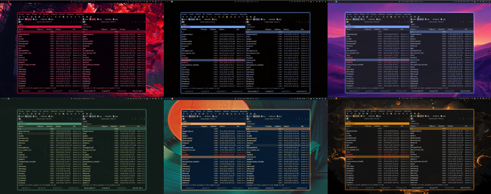
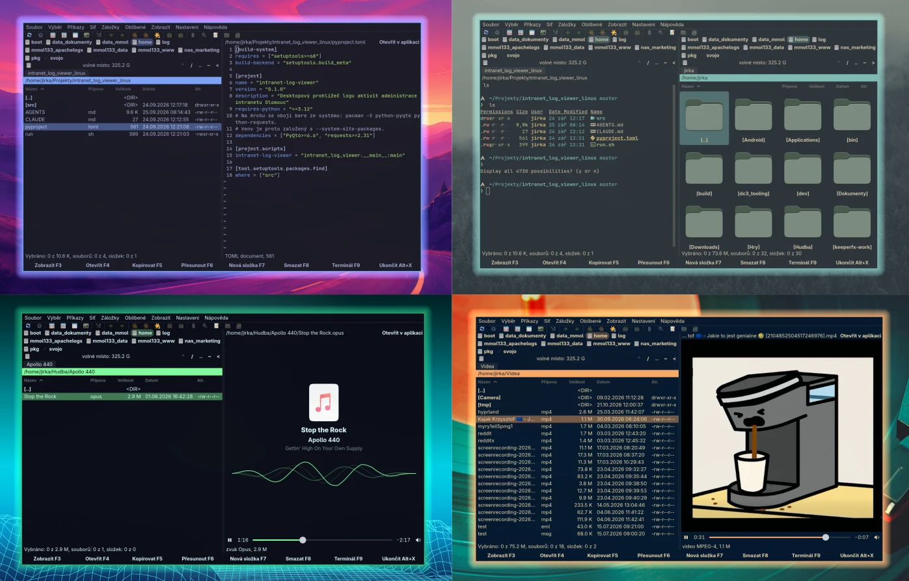

# Douby Commander



A two-panel file manager for Linux, written in Rust with GTK 4 and libadwaita.

Douby Commander is a tribute to [Double Commander](https://github.com/doublecmd/doublecmd),
the great open-source file manager inspired by Total Commander. It rewrites Double Commander
from Free Pascal into fast, idiomatic Rust, step by step: not a line-by-line port, but true
to its look, its keyboard shortcuts and how it feels to use. The "D" of Double stays in
the name and the abbreviation DC.

It follows the theme of [Omarchy](https://omarchy.org/) live: switch the theme and the
colors change at once, with no setup.

> **Alpha (0.0.21).** Many features are not done yet. Most menu items and toolbar buttons
> are not connected, and there is no settings dialog. Expect rough edges.

## What works



*F3 quick view of a TOML file, a song and a video; a panel turned into a terminal (F9) next to
the icons view.*

- Two panels, keyboard driven: Tab, quick search by typing, marking with Insert, Space
  and Shift; `+` and `-` select and unselect a group by a mask (`*.doc;*.odt`), `*` inverts
  the selection; Alt+Right in the left panel opens the directory under the cursor in the right
  one, Alt+Left the other way round
- Three views: details, list (names in columns) and icons with image previews
- Space on a directory calculates its size in the background
- Archives with a directory of their contents (zip, 7z, rar, iso, cab, tar) are shown
  like directories, `[name].zip` in bold, and browsed like them; F5 extracts from them
- F3 quick view in the other panel, following the cursor: text and source code with syntax
  highlighting (Neovim, read only), images, video, and music with its tags, cover and a wave
  that moves with what plays, PDF as pages to scroll through. Other files show what the
  programs installed on the system tell (exiftool, pandoc, fluidsynth, thumbnailers of the
  desktop); missing ones are offered on the strip at the bottom
  Esc closes it, Tab closes it and goes to the other panel
- Enter and F4 open a file in its default application, Shift+F4 offers the applications
  that can open it
- F5 copy and F6 move, with the questions and options of the original, a progress
  window, pause, and queues
- Shift+F6 or F2 renames the file under the cursor right in the list
- A double click on the path above a panel lets you type where to go (`~`, `$VARIABLES`
  and relative paths work). The button at its end says what Enter does: go there, or
  create the missing directories (how many) and go there; a key shows when you may not
  create them
- Ctrl+M renames many files at once: masks with placeholders (`[N]`, `[E]`, counter,
  date and time), find and replace with regular expressions, letter case, live preview
- Alt+F7 finds files as the original does: names by masks or regular expressions,
  excluded files and directories, depth, inside archives, text in files (any case,
  regular expressions, hexadecimal bytes, other encodings, files *not* containing it,
  replacing it), in the text of documents (OpenDocument, Office, EPUB by itself; PDF,
  DjVu, RTF and old Word files through the tools of your system, offered to install), modification time, size, file types and permissions,
  duplicate files. Searches can be saved under a name. The results go to the file
  or into the panel, to copy, move or delete them as files of a directory
- Add-ons: Linux tools instead of plugins, see below
- Ctrl+. shows hidden files, also from the Show menu
- F7 new directory, F8 delete (to the trash, or permanently with Shift)
- F9 switches the panel's view in turn: list, details, icons and a terminal that follows
  the panel's directory (`exit` closes it). Shift+F9 opens your own terminal
- Sorting by clicking the column headers, from the Show menu or with Ctrl+F3 to Ctrl+F6
- Adjustable panel divider, drive list with free space
- Command line: `doubycmd PATH` opens the path in the active panel, `doubycmd LEFT RIGHT`
  both panels; `-L`, `-R` and `-P L|R` (active panel) as in the original, `doubycmd --help`
  lists them. A file opens its directory with the cursor on it. With Douby Commander
  running already, it goes there in the running window. It can open folders from other
  applications
- English and Czech

## Linux tools instead of plugins

Double Commander, like Total Commander, grows through plugins: WCX for archives, WDX for
file properties, WLX for viewers, DSX for searching. Each of them is a library written for
it, on Windows often the only way to read a format. Douby Commander has no plugins and
never will. It runs on Linux only, and on Linux the package manager of your distribution
already has a tool for nearly every format: Poppler for PDF, pandoc for documents and
books, exiftool for metadata, the thumbnailers of the desktop, and many more. Douby
Commander uses what is installed, and asks for nothing that is not needed.

We call these tools **add-ons**. Nothing is pulled in as a dependency of the package: who
never opens a DjVu file never installs a DjVu tool. When a function would do more with a
tool you do not have, a strip at the bottom of its window says so, with what the tool
would add. Click Install, choose what you want, give the administrator password in the
window that asks for it, and watch the strip: the package manager of your distribution
installs it right away (pacman, apt, dnf or zypper, through sudo). The function uses the
tool from then on, no restart. Configuration > Add-ons lists every add-on there is.

| Function | Tool | Package on Arch | What it adds |
|---|---|---|---|
| Quick view (F3) | `nvim` | neovim | text and source code with syntax highlighting |
| | `pdftoppm`, `pdfinfo` | poppler | PDF documents page by page |
| | `fluidsynth` | fluidsynth | list of instruments in SoundFont banks |
| | `pandoc` | pandoc-cli | beginning of the text of books and documents |
| | `exiftool` | perl-image-exiftool | metadata of almost any file |
| | thumbnailers | evince, libgsf, gnome-epub-thumbnailer, gnome-font-viewer | pictures of documents, covers of e-books, samples of fonts |
| Find files (Alt+F7), text of documents | `pdftotext` | poppler | text of PDF documents |
| | `djvutxt` | djvulibre | text of DjVu documents |
| | `pandoc` | pandoc-cli | text of RTF documents |
| | `catdoc` | catdoc | text of old Word documents (.doc) |

OpenDocument, Office Open XML, EPUB and FictionBook files are read by Douby Commander
itself, they are zips of XML. The package names for Debian, Fedora and openSUSE are known
too.

## Installing

Ready-made packages are the quickest way, nothing to compile. Download one from
[Releases](https://github.com/DoubyCz/douby-commander/releases) (x86_64, needs GTK 4.16,
libadwaita 1.6 and glibc 2.41 or newer) and install it:

| System | Command |
|---|---|
| Debian 13, Ubuntu 25.04 and newer | `sudo apt install ./douby-commander_*_amd64.deb` |
| Fedora 42 and newer | `sudo dnf install ./douby-commander-*.x86_64.rpm` |
| Arch, Omarchy and others | `tar -xzf douby-commander-*-x86_64-linux.tar.gz -C ~/.local` |

The tarball can also go to `/usr/local` for all users (`sudo tar ... -C /usr/local`).
Douby Commander then shows up in the application launcher.

### From source

Only when no package fits, e.g. another architecture or RHEL 10. You need Rust 1.92 or
newer, GTK 4.16 and libadwaita 1.6 or newer with development files, and gettext. First
install them for your distribution.

Arch Linux (Omarchy):

```sh
sudo pacman -S --needed base-devel rust gtk4 libadwaita libarchive vte4 gstreamer gst-plugins-good gettext
```

Debian 13, Ubuntu 25.04 and newer:

```sh
sudo apt install build-essential pkg-config libgtk-4-dev libadwaita-1-dev libarchive-dev libvte-2.91-gtk4-dev libgstreamer1.0-dev gstreamer1.0-plugins-good gettext
curl --proto '=https' --tlsv1.2 -sSf https://sh.rustup.rs | sh
```

Fedora, RHEL 10 and derivatives:

```sh
sudo dnf install gcc pkgconf-pkg-config gtk4-devel libadwaita-devel libarchive-devel vte291-gtk4-devel gstreamer1-devel gstreamer1-plugins-good gettext
curl --proto '=https' --tlsv1.2 -sSf https://sh.rustup.rs | sh
```

Then, the same everywhere:

```sh
git clone https://github.com/DoubyCz/douby-commander.git
cd douby-commander
./install.sh
```

This builds it and installs it for you into `~/.local`, with a launcher entry and an icon.
For all users: `cargo build --release && sudo PREFIX=/usr/local ./install.sh --no-build`.
`./install.sh --uninstall` removes it (with the same `PREFIX`).

## License

GPL-2.0-or-later, as Double Commander. Icons come from Double Commander.
