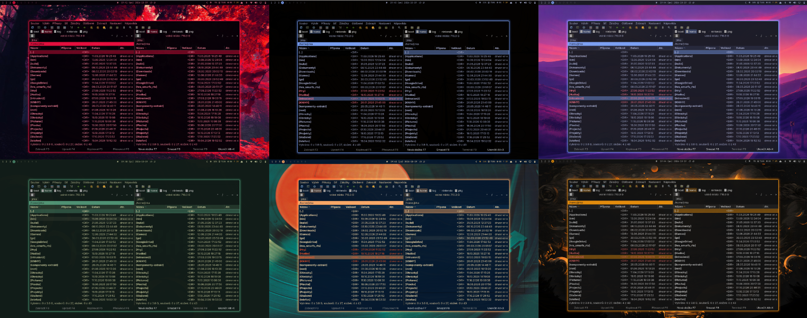
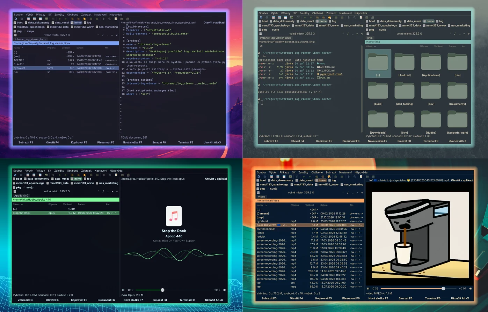

# Douby Commander



A two-panel file manager for Linux, written in Rust with GTK 4 and libadwaita.

Douby Commander is a tribute to [Double Commander](https://github.com/doublecmd/doublecmd),
the great open-source file manager inspired by Total Commander. It rewrites Double Commander
from Free Pascal into fast, idiomatic Rust, step by step: not a line-by-line port, but true
to its look, its keyboard shortcuts and how it feels to use. The "D" of Double stays in
the name and the abbreviation DC.

It follows the theme of [Omarchy](https://omarchy.org/) live: switch the theme and the
colors change at once, with no setup.

> **Alpha (0.0.11).** Many features are not done yet. Most menu items and toolbar buttons
> are not connected, and there is no settings dialog. Expect rough edges.

## What works



*F3 quick view of a TOML file, a song and a video; a panel turned into a terminal (F9) next to
the icons view.*

- Two panels, keyboard driven: Tab, quick search by typing, marking with Insert, Space
  and Shift; Alt+Left and Alt+Right go up and into directories
- Three views: details, list (names in columns) and icons with image previews
- Space on a directory calculates its size in the background
- Archives with a directory of their contents (zip, 7z, rar, iso, cab, tar) are shown
  like directories, `[name].zip` in bold, and browsed like them; F5 extracts from them
- F3 quick view in the other panel, following the cursor: text and source code with syntax
  highlighting (Neovim, read only), images, video, and music with its tags, cover and a wave
  that moves with what plays. Esc closes it, Tab closes it and goes to the other panel
- Enter and F4 open a file in its default application, Shift+F4 offers the applications
  that can open it
- F5 copy and F6 move, with the questions and options of the original, a progress
  window, pause, and queues
- Shift+F6 or F2 renames the file under the cursor right in the list
- Ctrl+M renames many files at once: masks with placeholders (`[N]`, `[E]`, counter,
  date and time), find and replace with regular expressions, letter case, live preview
- F7 new directory, F8 delete (to the trash, or permanently with Shift)
- F9 turns the panel into a terminal that follows the panel's directory; the view
  shortcuts bring the files back, `exit` closes it. Shift+F9 opens your own terminal
- Sorting by clicking the column headers, from the Show menu or with Ctrl+F3 to Ctrl+F6
- Adjustable panel divider, drive list with free space
- English and Czech

## Installing

Ready-made packages are the quickest way, nothing to compile. Download one from
[Releases](https://github.com/DoubyCz/douby-commander/releases) (x86_64, needs GTK 4.16,
libadwaita 1.6 and glibc 2.41 or newer) and install it:

| System | Command |
|---|---|
| Debian 13, Ubuntu 25.04 and newer | `sudo apt install ./douby-commander_*_amd64.deb` |
| Fedora 42 and newer | `sudo dnf install ./douby-commander-*.x86_64.rpm` |
| Arch, Omarchy and others | `tar -xzf douby-commander-*-x86_64-linux.tar.gz -C ~/.local` |

The tarball can also go to `/usr/local` for all users (`sudo tar ... -C /usr/local`).
Douby Commander then shows up in the application launcher.

### From source

Only when no package fits, e.g. another architecture or RHEL 10. You need Rust 1.92 or
newer, GTK 4.16 and libadwaita 1.6 or newer with development files, and gettext. First
install them for your distribution.

Arch Linux (Omarchy):

```sh
sudo pacman -S --needed base-devel rust gtk4 libadwaita libarchive vte4 gstreamer gst-plugins-good gettext
```

Debian 13, Ubuntu 25.04 and newer:

```sh
sudo apt install build-essential pkg-config libgtk-4-dev libadwaita-1-dev libarchive-dev libvte-2.91-gtk4-dev libgstreamer1.0-dev gstreamer1.0-plugins-good gettext
curl --proto '=https' --tlsv1.2 -sSf https://sh.rustup.rs | sh
```

Fedora, RHEL 10 and derivatives:

```sh
sudo dnf install gcc pkgconf-pkg-config gtk4-devel libadwaita-devel libarchive-devel vte291-gtk4-devel gstreamer1-devel gstreamer1-plugins-good gettext
curl --proto '=https' --tlsv1.2 -sSf https://sh.rustup.rs | sh
```

Then, the same everywhere:

```sh
git clone https://github.com/DoubyCz/douby-commander.git
cd douby-commander
./install.sh
```

This builds it and installs it for you into `~/.local`, with a launcher entry and an icon.
For all users: `cargo build --release && sudo PREFIX=/usr/local ./install.sh --no-build`.
`./install.sh --uninstall` removes it (with the same `PREFIX`).

## License

GPL-2.0-or-later, as Double Commander. Icons come from Double Commander.
